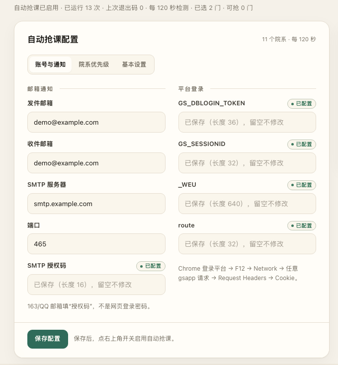

# USTC 报告选课助手

基于 [1540975647/ustc_grab_report_course](https://github.com/1540975647/ustc_grab_report_course) 的
macOS / Windows 图形化版本。保留自动抢课核心，界面只做三件事：

- **自动抢课配置**：邮箱、平台 Cookie、院系优先级、检测间隔
- **已选报告预览**：打开页面自动读取，也可以手动刷新
- **启用 / 停止**：右上角开关控制定时任务

> **免责声明**：本项目仅用于个人学习自动化与系统实践，通过低频请求监控学术报告并发送通知。
> 请勿修改为高频访问或用于突破平台限制；因使用不当导致账号被限制的，后果自负。



*账号与通知分段（演示配置，未包含真实凭据）*

## 功能

- **图形界面**：本地浏览器打开，配置分“账号与通知 / 院系优先级 / 基本设置”三段。
- **跨平台**：macOS 使用 launchd，Windows 使用任务计划程序；核心逻辑纯 Python。
- **按应用缓存 `_WEU`**：平台每个应用的 `_WEU` 不同，客户端自动获取、缓存并在失效时重试。
- **院系优先级**：按你指定的院系顺序排序；时间冲突时优先靠前的院系。
- **安全限流**：默认每轮最多成功选 1 门、最多尝试 3 门，检测间隔默认 120 秒。
- **邮件通知**：选课成功、退课成功、成绩更新、Cookie 过期；过期提醒只发一次。
- **排除课程**：命中 `data/exclude.json` 的课程不会被选；若已选会自动退课。

## 快速开始

要求：Python **3.9+**，能访问 `https://yjs1.ustc.edu.cn`。

### macOS

```bash
git clone https://github.com/QcShadow/ustc_grab_report_course.git
cd ustc_grab_report_course
python3 -m venv venv
./venv/bin/pip install -r requirements.txt
./venv/bin/python gui.py
```

也可以双击项目根目录的 `start_gui.command`。

配置与数据保存在：

```text
~/Library/Application Support/USTC-Grab/report-course
```

macOS 的后台任务（launchd）不能读取桌面目录，所以运行时使用 Application Support，而不是仓库目录。

### Windows

1. 安装 Python 3.9+，安装时勾选 **Add Python to PATH**。
2. 克隆或解压本项目。
3. 双击 **`setup_windows.bat`**。

脚本会自动创建 `venv`、安装依赖并启动 GUI；之后可以双击 `start_gui.bat` 再次打开。
Windows 的配置与数据就在项目目录下。

## 使用

1. 填发件邮箱、收件邮箱、SMTP 服务器、端口、授权码。
   - 163：`smtp.163.com:465`
   - QQ：`smtp.qq.com:465`
   - 授权码不是邮箱登录密码。
2. 填平台 Cookie：Chrome 登录 → F12 → Network → 任意 `gsapp` 请求 → Request Headers → `Cookie`。
3. 切换到“院系优先级”，调整顺序。越靠前优先级越高。
4. 切换到“基本设置”，设置检测间隔和是否查询成绩。
5. 点 **保存配置**。
6. 打开右上角“自动抢课”开关。
7. 右侧“已选报告”会自动刷新，也可以手动刷新。

配置分段切换不会丢失未保存的输入。关闭右上角开关即停止抢课，配置和数据会保留。

## 配置

配置文件：

```text
# macOS
~/Library/Application Support/USTC-Grab/report-course/config.yml

# Windows
项目目录\config.yml
```

必填：

| 项 | 说明 |
| --- | --- |
| `email.sender` / `email.receiver` | 发件、收件邮箱 |
| `email.smtp.server` / `port` | SMTP 服务器与端口（SSL） |
| `email.smtp.auth_code` | SMTP 授权码 / 客户端授权密码 |
| `cookies.GS_DBLOGIN_TOKEN` | 平台登录 Cookie |
| `cookies.GS_SESSIONID` | 平台会话 Cookie |
| `cookies._WEU` | 应用令牌，客户端会自动刷新 |
| `cookies.route` | 平台路由 Cookie |

可选 / 高级参数（GUI 不展示，直接改 `config.yml`）：

| 项 | 默认 | 说明 |
| --- | --- | --- |
| `schedule_interval_seconds` | `120` | 检测间隔 |
| `enable_grade_check` | `false` | 是否查成绩 |
| `max_grabs_per_cycle` | `1` | 每轮最多成功选几门 |
| `conflict_window_minutes` | `120` | 时间冲突窗口 |
| `data_raw.pageSize` | `999` | 一次取回的候选数 |
| `enable_keepalive` | `false` | 保活任务（通常不需要） |

`config.yml` 含平台登录态和邮箱授权码，权限为 `600`，**不要提交到 Git**。
GUI 保存时会自动备份为 `config.yml.bak`。

### 院系优先级

默认顺序：

1. 人工智能与数据科学学院 `229`
2. 计算机科学与技术学院 `011`
3. 信息科学技术学院 `210`
4. 自动化系 `010`
5. 电子工程与信息科学系 `006`
6. 软件学院 `225`
7. 软件学院合肥 `A13`
8. 网络空间安全学院 `221`
9. 微电子学院 `219`

`data_raw.querySetting` 的 `YXDM` 中 `value` 和 `value_display` 必须一一对应，顺序就是优先级。

### 排除课程

`data/exclude.json` 中的课程不会被选；如果已经选了，会自动退课。

```json
{
  "EXCLUDE_BGBM": [
    "04cba049ba9a4fcba73e4800ba1607d3"
  ]
}
```

## 自检

只读验证平台会话和 SMTP 登录（不发邮件）：

```bash
# macOS
./venv/bin/python scripts/macos/preflight.py --network --smtp

# Windows
venv\Scripts\python.exe scripts\macos\preflight.py --network --smtp
```

`--network` 只发一次只读查询；`--smtp` 只登录、不发信。

## 工作原理

服务端先按 `YXDM` 白名单查询；客户端再过滤：

1. 院系必须在白名单中
2. `BGSJ`（报告时间）晚于当前
3. `JZSJ`（报名截止）晚于当前
4. `KXRS`（可选人数）大于 `YXRS`（已选人数）
5. `BGBM` 不在 `data/exclude.json` 中

候选排序：**院系优先级 → 报名截止升序 → 报告时间升序**。
时间冲突窗口默认 120 分钟；每轮最多成功选 1 门。

### `_WEU` 与保活

平台的 `_WEU` 按应用隔离，而且会过期。客户端会：

- 把每个应用的 `_WEU` 缓存在 `data/weu_cache.json`
- 正常请求直接用缓存
- 遇到 403 或令牌失效时，访问对应应用首页获取新令牌并重试一次

所以**不需要保活任务**。原项目的保活是每 30 分钟退掉一门真实课程再抢回来，借写操作刷新
`_WEU`，有丢课风险；现在默认关闭，`particular_course.BGBM` 可以留空。

## 定时任务

在 GUI 右上角打开开关即可。手动安装：

### macOS

```bash
cd "$(git rev-parse --show-toplevel)"
START_INTERVAL=120 bash scripts/macos/install_launchd.sh
```

- Label：`com.ustc.grab.report`
- 状态：`launchctl print gui/$(id -u)/com.ustc.grab.report | grep -E 'state|last exit|runs'`
- 日志：`~/Library/Application Support/USTC-Grab/report-course/logs/main.log`
- 卸载：`bash scripts/macos/uninstall_launchd.sh`

### Windows

```powershell
powershell -ExecutionPolicy Bypass -File scripts\windows\install_task.ps1 -IntervalMinutes 2
```

- 任务名：`USTC-Grab-Report`
- 状态：`Get-ScheduledTask -TaskName "USTC-Grab-Report"`
- 日志：`logs\main.log`
- 卸载：`powershell -ExecutionPolicy Bypass -File scripts\windows\uninstall_task.ps1`

电脑睡眠或合盖时任务暂停，唤醒后继续。

## 给 AI Agent 的安装提示词

把下面整段复制给有本机终端权限的 Agent（Claude Code / Codex / Cursor 等）。
它会先向你索取凭据，再完成安装；没有凭据时不会伪造。

```text
你是一名负责在用户本机部署 Python 项目的工程师。当前目录就是项目根目录，请先阅读 README.md。

目标：安装依赖、生成并填写 config.yml、验证平台与 SMTP、安装定时任务，最后启动 GUI 并确认首轮运行成功。

硬性约束：
- 不要伪造 Cookie、邮箱授权码、课程编号；缺少凭据时停下来向用户索取，不要用占位符假装成功。
- 不要使用 sudo，不要安装 Homebrew、Node.js 或额外系统包。
- 不要修改抢课核心逻辑；检测间隔默认 120 秒，不要低于 120 秒。
- 不要启用保活任务，保持 enable_keepalive: false。
- 修改已有 config.yml 前备份为 config.yml.bak，权限设为 600。
- 所有密钥只写入 config.yml，不要 echo、不要写日志、不要提交 Git、不要出现在最终摘要。
- 注册系统定时任务前，先向用户确认；不要发布到 GitHub，除非用户明确要求。

步骤：
1. 识别系统（macOS / Windows / Linux）、Python 版本（>=3.9）和项目根目录。
2. 创建或复用 venv，并安装依赖：
   macOS/Linux: python3 -m venv venv && ./venv/bin/pip install -r requirements.txt
   Windows: py -3 -m venv venv && venv\Scripts\python.exe -m pip install -r requirements.txt
3. 确定配置目录：
   macOS: $HOME/Library/Application Support/USTC-Grab/report-course
   Windows/Linux: 项目根目录
   创建 data/ 和 logs/，如果 config.yml 不存在，从 templates/config.template.yml 复制。
4. 向用户索取：
   - 发件邮箱、收件邮箱、SMTP 服务器、端口、SMTP 授权码
   - 四个 Cookie：GS_DBLOGIN_TOKEN、GS_SESSIONID、_WEU、route
   - 院系优先级（默认 9 个：229,011,210,010,006,225,A13,221,219）
   - 是否查询成绩（默认 false）
   - 检测间隔秒数（默认 120）
   如果用户没有 Cookie，指导他登录 https://yjs1.ustc.edu.cn，F12 → Network → 任意 gsapp 请求 →
   Request Headers → 复制 Cookie。不要尝试自动读取浏览器凭据。
5. 用 PyYAML 写入 config.yml：
   - email.sender / receiver / smtp.server / port / auth_code
   - cookies 四个字段
   - data_raw.querySetting 的 YXDM value 和 value_display，按用户顺序一一对应
   - data_raw.pageSize: 999
   - enable_grade_check、schedule_interval_seconds
   - max_grabs_per_cycle: 1、conflict_window_minutes: 120、enable_keepalive: false
   保留 headers、base_url、urls、data_raw 其他字段和已有配置。
6. 运行自检：
   macOS: ./venv/bin/python scripts/macos/preflight.py --network --smtp
   Windows: venv\Scripts\python.exe scripts\macos\preflight.py --network --smtp
   如果 403，通常是 Cookie 过期；让用户重新抓 Cookie，不要降低检测频率。
7. 如果 enable_grade_check 为 true，先运行一次预热，避免历史成绩被当成新成绩群发：
   macOS: ./venv/bin/python scripts/macos/prime_grades.py
   Windows: venv\Scripts\python.exe scripts\macos\prime_grades.py
8. 向用户确认后安装定时任务：
   macOS: START_INTERVAL=120 bash scripts/macos/install_launchd.sh
   Windows: powershell -ExecutionPolicy Bypass -File scripts\windows\install_task.ps1 -IntervalMinutes 2
9. 验证：
   macOS: launchctl print gui/$(id -u)/com.ustc.grab.report | grep -E 'state|last exit|runs'
   Windows: Get-ScheduledTask -TaskName "USTC-Grab-Report"
   查看 logs/main.log，确认最近一轮 exit 0 且能读取已选报告。
10. 启动 GUI：
    macOS: ./venv/bin/python gui.py 或双击 start_gui.command
    Windows: start_gui.bat
    把终端打印的带 token 的本地地址告诉用户；不要把 token 发给其他人。
11. 输出一份不含密钥的摘要：平台、配置路径、服务状态、首轮结果、下一步。
    如果任何一步失败，报告具体错误并停止，不要假装成功。
```

## 安全与隐私

- `config.yml` 含平台登录态和邮箱授权码，权限 `600`，**不要提交到 Git**。
- GUI 只监听 `127.0.0.1`，每次启动生成随机访问令牌，不向外部上传配置。
- 日志不含 Cookie 或授权码；GUI 状态接口只返回密钥是否存在及长度。
- 这些凭据等同于登录态和发信权限，请勿分享配置文件、截图或带 token 的地址。
- 建议使用专门的收件邮箱；不要把邮箱登录密码填进 SMTP 授权码字段。

## 常见问题

**平台返回 403 / “cookie 可能已过期”？**
通常是 `_WEU` 属于别的应用，客户端会自动刷新并重试。如果 `GS_DBLOGIN_TOKEN` 或
`GS_SESSIONID` 也过期，需要重新抓 Cookie 填入 GUI。

**SMTP 报 `535 authentication failed`？**
填了登录密码而不是授权码，或授权码已失效。修改授权码并保存配置后，下一次通知会使用新值；
也可以用上面的 `preflight.py --smtp` 只验证登录（不发信）。

**一直显示 0 门可抢？**
查看“已选报告”上方的可抢数量；可能是当前没有未来报告、名额已满、院系不在白名单，或报告时间已过。
“已选报告”仍然可以正常读取，说明登录态通常没问题。

**macOS 安装后没有运行？**
检查 `launchctl print gui/$(id -u)/com.ustc.grab.report` 和
`~/Library/Application Support/USTC-Grab/report-course/logs/main.log`。
macOS 的 TCC 保护要求运行时放在 Application Support，不能放桌面。

**Windows 任务没有运行？**
任务计划程序需要用户已登录；检查 `Get-ScheduledTask -TaskName "USTC-Grab-Report"`，
确认项目目录没有被移动，并查看 `logs\main.log`。

**电脑睡眠时会跑吗？**
不会。macOS 合盖/睡眠会暂停 launchd，Windows 睡眠也会暂停任务；唤醒后继续。

**保活任务是什么？**
原项目每 30 分钟退掉一门真实课程再抢回来，借写操作刷新 `_WEU`。现在改成访问应用首页
自动刷新，默认不安装保活任务，避免丢课风险。

**GUI 打不开或提示未授权？**
回到启动 GUI 的终端，使用打印出来的带 `token` 的地址；GUI 只监听 `127.0.0.1`。

## 目录结构

```text
.
├── gui.py                     # GUI 入口
├── main.py                    # 单轮检测
├── ustc_grab/                 # 核心包
│   ├── client.py              # 请求、按应用缓存 _WEU、403 重试
│   ├── config.py              # 配置读取
│   ├── manager.py             # 筛选、排序、抢课、成绩
│   ├── notification.py        # 邮件
│   └── gui/                   # 本地 Web GUI（后端 + 前端）
├── scripts/
│   ├── macos/                 # launchd 安装、卸载、自检、预热
│   ├── windows/               # 任务计划安装、卸载
│   └── run_job.py             # 跨平台单轮入口
├── templates/                 # 配置与排除列表模板
├── data/                      # 运行时数据
├── setup_windows.bat          # Windows 一键安装/启动
├── start_gui.bat              # Windows 再次打开 GUI
└── start_gui.command          # macOS 双击启动 GUI
```

`config.yml`、`config.yml.bak`、`data/weu_cache.json`、`logs/`、`venv/` 都是本地运行时内容，
已在 `.gitignore` 中忽略。

## 开发

```bash
python3 -m venv venv
./venv/bin/pip install -r requirements.txt
./venv/bin/python gui.py --help
./venv/bin/python gui.py --home /tmp/ustc-gui-demo --no-browser
```

GUI 使用 Python 标准库 `http.server` + 原生 HTML/CSS/JS，不需要 Node.js 或前端构建。

## 许可与致谢

- 原项目：[1540975647/ustc_grab_report_course](https://github.com/1540975647/ustc_grab_report_course)
- 本改造版：macOS / Windows 部署、GUI、按应用 `_WEU`、院系优先级与时间冲突、限流与邮件去重
- License：[MIT](LICENSE)
