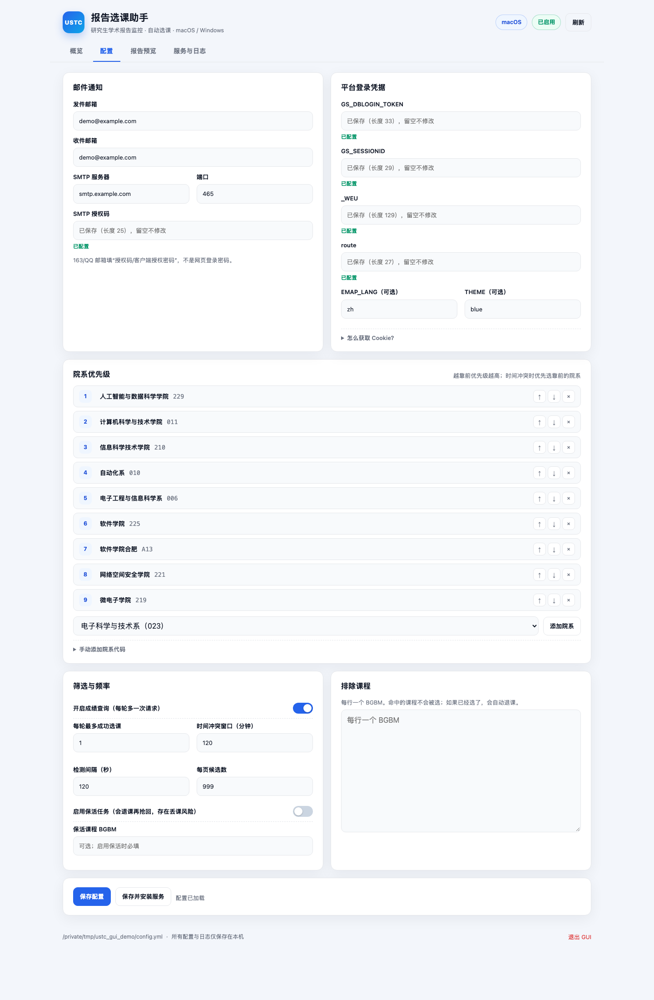

# USTC 研究生学术报告监控与自动选课

> 基于 [1540975647/ustc_grab_report_course](https://github.com/1540975647/ustc_grab_report_course) 的跨平台改造版。
> 新增图形界面、macOS launchd / Windows 任务计划、按应用缓存 `_WEU`、院系优先级与时间冲突处理、
> 每轮限选和邮件去重。
>
> **郑重声明**：本项目仅用于个人学习自动化与系统实践，通过低频请求监控学术报告并发送通知。
> 请勿修改为高频访问或用于突破平台限制；因使用不当导致账号被限制的，后果自负。

## 功能

- **图形界面**：浏览器中填写邮箱、Cookie、院系优先级和筛选条件，一键测试与安装服务。
- **跨平台**：macOS 使用 launchd，Windows 使用任务计划程序；核心逻辑纯 Python，无平台绑定。
- **按应用缓存 `_WEU`**：平台的 `_WEU` 按应用隔离，客户端自动获取、缓存并在失效时重试。
- **院系优先级**：按你指定的院系顺序排序；时间冲突时优先靠前的院系。
- **安全限流**：每轮最多成功选 1 门、最多尝试 3 门；检测间隔可配置（默认 120 秒）。
- **邮件通知**：选课成功、退课成功、成绩更新、Cookie 过期；过期提醒只发一次。
- **排除课程**：`data/exclude.json` 中的课程不会被选；若已选会自动退课。
- **日志与诊断**：GUI 内查看运行日志、测试 SMTP 和平台连接、预览当前可抢报告。

## 界面预览



*界面示意，使用虚构的演示配置。*

## 快速开始

要求：Python **3.9+**，能访问 `https://yjs1.ustc.edu.cn`。

### macOS

```bash
git clone https://github.com/QcShadow/ustc_grab_report_course.git
cd ustc_grab_report_course
python3 -m venv venv
source venv/bin/activate
pip install -r requirements.txt
python gui.py
```

GUI 会在浏览器打开。配置与数据保存在：

```text
~/Library/Application Support/USTC-Grab/report-course
```

macOS 的后台任务（launchd）不能读取桌面目录，所以运行时使用 Application Support，而不是仓库目录。

### Windows

1. 安装 Python 3.9+，安装时勾选 **Add Python to PATH**。
2. 克隆或解压本项目。
3. 双击 **`setup_windows.bat`**。

脚本会自动创建 `venv`、安装依赖并启动 GUI。之后可以双击 `start_gui.bat` 再次打开。

Windows 的配置与数据就在项目目录下（`config.yml`、`data/`、`logs/`）。

## 第一次使用

1. **邮件通知**：填写发件邮箱、收件邮箱、SMTP 服务器、端口和授权码。
   - 163：`smtp.163.com:465`，授权码在网页版“设置 → POP3/SMTP/IMAP”开启。
   - QQ：`smtp.qq.com:465`，授权码在“设置 → 账户”开启 SMTP 后获取。
   - 授权码不是邮箱登录密码。
2. **平台 Cookie**：Chrome 登录 `https://yjs1.ustc.edu.cn`，F12 → Network → 任意 `gsapp` 请求 →
   Request Headers → 复制 `Cookie:` 后面的整段，按分号拆成四个字段填入。
   - `GS_DBLOGIN_TOKEN`
   - `GS_SESSIONID`
   - `_WEU`
   - `route`
   - `_WEU` 不需要手动续期，客户端会按应用自动刷新并缓存。
3. **院系优先级**：添加院系，用 ↑ ↓ 调整顺序。越靠前优先级越高。
4. **筛选条件**：设置检测间隔、每轮最多选几门、时间冲突窗口、是否查成绩。
5. **保存配置**，然后点“测试 SMTP”“测试平台连接”确认可用。
6. 点“报告预览”查看当前可抢报告和已选报告。
7. 点“安装 / 更新定时任务”，服务开始自动运行。

## 配置说明

| 配置项 | 说明 | 默认 |
| --- | --- | --- |
| `email.sender` / `email.receiver` | 发件、收件邮箱 | 必填 |
| `email.smtp.server` / `port` | SMTP 服务器与端口（SSL） | `smtp.qq.com:465` |
| `email.smtp.auth_code` | SMTP 授权码 / 客户端授权密码 | 必填 |
| `cookies.GS_DBLOGIN_TOKEN` | 平台登录 Cookie | 必填 |
| `cookies.GS_SESSIONID` | 平台会话 Cookie | 必填 |
| `cookies._WEU` | 应用令牌，自动刷新 | 必填 |
| `cookies.route` | 平台路由 Cookie | 必填 |
| `data_raw.querySetting` 的 `YXDM` | 院系白名单，逗号分隔，顺序即优先级 | 9 个院系 |
| `enable_grade_check` | 是否查询成绩 | `false` |
| `max_grabs_per_cycle` | 每轮最多成功选几门 | `1` |
| `conflict_window_minutes` | 开始时间相差小于该值视为冲突 | `120` |
| `schedule_interval_seconds` | 定时检测间隔（秒） | `120` |
| `enable_keepalive` | 是否安装保活任务 | `false` |
| `particular_course.BGBM` | 保活课程编号（启用保活时必填） | 空 |
| `data_raw.pageSize` | 一次取回多少候选 | `999` |
| `interval` | 保活任务退课后等待秒数 | `30` |

`data/exclude.json` 用于排除不想选的课程：

```json
{
  "EXCLUDE_BGBM": [
    "04cba049ba9a4fcba73e4800ba1607d3"
  ]
}
```

GUI 的“排除课程”文本框每行填一个 `BGBM`。

## 筛选逻辑

服务端先按 `YXDM` 白名单查询；客户端再过滤：

1. 院系必须在白名单中（双保险）
2. `BGSJ`（报告时间）晚于当前
3. `JZSJ`（报名截止）晚于当前
4. `KXRS`（可选人数）大于 `YXRS`（已选人数）
5. `BGBM` 不在 `data/exclude.json` 中

候选排序：**院系优先级 → 报名截止升序 → 报告时间升序**。

时间冲突：两场报告开始时间相差小于 `conflict_window_minutes`（默认 120 分钟）视为冲突。
每轮最多成功选 1 门，因此优先提交优先级最高的候选；把 `max_grabs_per_cycle` 调大后，
脚本会跳过与本轮已选报告冲突的低优先级候选。

已经选上的课程不会被自动替换；如果新报告与已选课程冲突，平台会拒绝，脚本会继续尝试其他候选。

## 定时任务

### macOS

GUI 点击“安装 / 更新定时任务”即可。手动安装：

```bash
cd "$(git rev-parse --show-toplevel)"
START_INTERVAL=120 bash scripts/macos/install_launchd.sh
```

- Label：`com.ustc.grab.report`
- 运行时：`~/Library/Application Support/USTC-Grab/report-course`
- 日志：`~/Library/Application Support/USTC-Grab/report-course/logs/main.log`
- 查看状态：`launchctl print gui/$(id -u)/com.ustc.grab.report | grep -E 'state|last exit'`
- 卸载：`bash scripts/macos/uninstall_launchd.sh`

详见 [DEPLOY_MACOS.md](DEPLOY_MACOS.md)。

### Windows

GUI 点击“安装 / 更新定时任务”，或手动执行：

```powershell
powershell -ExecutionPolicy Bypass -File scripts\windows\install_task.ps1 -IntervalMinutes 2
```

- 任务名：`USTC-Grab-Report`
- 可选保活任务：`USTC-Grab-Keepalive`（加 `-EnableKeepalive`）
- 日志：`logs\main.log`
- 查看任务：`Get-ScheduledTask -TaskName "USTC-Grab-Report"`
- 卸载：`powershell -ExecutionPolicy Bypass -File scripts\windows\uninstall_task.ps1`

详见 [DEPLOY_WINDOWS.md](DEPLOY_WINDOWS.md)。

### 手动运行

```bash
python main.py             # 跑一轮检测
python main_update_weu.py  # 跑一次保活（可选）
python scripts/run_job.py main  # 带锁和日志的单轮入口
```

## 命令行工具

```bash
# 配置自检（可选 --network / --smtp）
python scripts/macos/preflight.py --network --smtp

# 首次开启成绩查询前预热，避免历史成绩被当成新成绩
python scripts/macos/prime_grades.py

# 直接跑一轮
python main.py
```

## 目录结构

```text
.
├── gui.py                     # GUI 入口
├── main.py                    # 单轮检测
├── main_update_weu.py         # 单次保活（可选）
├── ustc_grab/                 # 核心包
│   ├── client.py              # 请求、按应用缓存 _WEU、403 重试
│   ├── config.py              # 配置读取
│   ├── manager.py             # 筛选、排序、抢课、成绩
│   ├── notification.py        # 邮件
│   └── gui/                   # 本地 Web GUI（后端 + 前端）
├── scripts/
│   ├── macos/                 # launchd 安装、卸载、自检、预热
│   ├── windows/               # 任务计划安装、卸载
│   └── run_job.py             # 跨平台单轮入口
├── templates/                 # 配置与排除列表模板
├── data/                      # 运行时数据（课程缓存、成绩、排除列表）
├── setup_windows.bat          # Windows 一键安装/启动
└── start_gui.bat              # Windows 再次打开 GUI
```

`config.yml`、`data/weu_cache.json`、`logs/`、`venv/` 都是本地运行时内容，
已在 `.gitignore` 中忽略，不会上传。

## 常见问题

**Q：平台返回 403 / “cookie 可能已过期”？**
A：通常是 `_WEU` 属于别的应用。客户端会自动打开对应应用首页刷新并重试。如果 `GS_DBLOGIN_TOKEN`
或 `GS_SESSIONID` 也过期，需要重新抓 Cookie 填入 GUI。

**Q：SMTP 报 `535 authentication failed`？**
A：填了登录密码而不是授权码，或授权码已失效。GUI 的“测试 SMTP”按钮只登录、不发信。

**Q：一直显示 0 门可抢？**
A：先点“报告预览”。可能是当前没有未来报告、名额已满、院系不在白名单，或报告时间已过。

**Q：macOS 安装后没有运行？**
A：检查 `launchctl print gui/$(id -u)/com.ustc.grab.report` 和
`~/Library/Application Support/USTC-Grab/report-course/logs/main.log`。
macOS 的 TCC 保护要求运行时放在 Application Support，不能放桌面。

**Q：Windows 任务没有运行？**
A：任务计划程序需要用户已登录；检查 `Get-ScheduledTask -TaskName "USTC-Grab-Report"`，
确认项目目录没有被移动，并查看 `logs\main.log`。

**Q：电脑睡眠时会跑吗？**
A：不会。macOS 合盖/睡眠会暂停 launchd，Windows 睡眠也会暂停任务；唤醒后继续。

**Q：保活任务是什么？**
A：原项目每 30 分钟退掉一门真实课程再抢回来，借写操作刷新 `_WEU`。
本项目已改为访问应用首页自动刷新，默认不安装保活任务，避免丢课风险。

**Q：GUI 打不开 / 提示未授权？**
A：回到启动 GUI 的终端，使用打印出来的带 `token` 的地址；GUI 只监听 `127.0.0.1`。

## 安全与隐私

- `config.yml` 包含平台 Cookie 和 SMTP 授权码，权限为 `600`，**不要提交到 Git**。
- GUI 只监听 `127.0.0.1`，每次启动生成随机访问令牌，不向外部上传配置。
- 日志不含 Cookie 或授权码；GUI 状态接口只返回密钥是否存在及长度。
- 这些凭据等同于登录态和发信权限，请勿分享截图或配置文件。

## 开发

```bash
python3 -m venv venv
source venv/bin/activate
pip install -r requirements.txt

python gui.py --help
python gui.py --home /tmp/ustc-gui-demo --no-browser
```

GUI 使用 Python 标准库 `http.server` + 原生 HTML/CSS/JS，不需要 Node.js 或前端构建。

## 致谢

- 原项目：[1540975647/ustc_grab_report_course](https://github.com/1540975647/ustc_grab_report_course)
- 本改造版：macOS / Windows 部署、GUI、按应用 `_WEU`、院系优先级与时间冲突、限流与邮件去重。

## License

[MIT](LICENSE)
